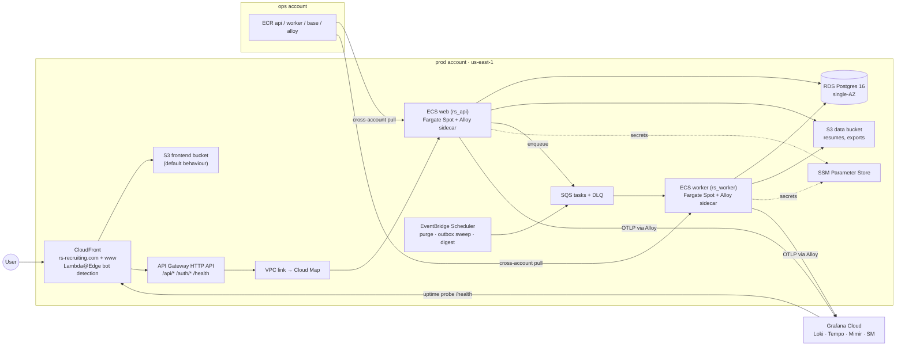
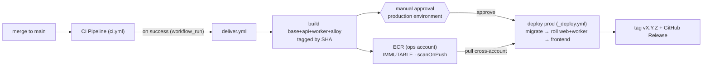

# Infrastructure — Current State

What runs in AWS, how it fits together, and *why* it was built this way.

**Source of truth:** the [`rs-recruiting-infra`](https://github.com/lahavrud/rs-recruiting-infra)
repo (OpenTofu + Terragrunt). This page summarises it for app developers and
deliberately carries no live resource IDs: they drift, and the infra repo has
them. When the two disagree, the infra repo wins — fix this page.

**Region:** `us-east-1` · **Accounts:** prod (`rs-recruiting-prod`) runs the app;
ops (`rs-recruiting-ops`) holds ECR and the Grafana control plane; management
holds the org, SSO, budgets and tfstate. Staging is retired and nothing is
deployed in its account.

For higher-level architectural decisions (auth model, framework choices, etc.)
see [`ARCHITECTURE.md`](./ARCHITECTURE.md).

---

## 1. Topology

### Network notes

- **One VPC, no NAT gateway, no ALB.** Tasks run in public subnets and reach the
  internet directly; an S3 gateway endpoint keeps S3 traffic in the VPC.
- **Ingress is CloudFront only.** `/api/*`, `/auth/*` and `/health` go to the
  API Gateway HTTP API, which reaches the web tasks through a VPC link and Cloud
  Map service discovery. Everything else is served from the frontend bucket.
- **DNS:** a Route 53 hosted zone for `rs-recruiting.com` in the prod account
  (`prod/dns`), with an ACM certificate in `us-east-1` for CloudFront.

---

## 2. Deploy pipeline

Trunk-based **continuous delivery** to ECS — see [`release-process.md`](./release-process.md) for the full flow and `.github/workflows/`.

Staging is retired for cost (the staging stage is preserved commented in
`deliver.yml`), so the build is promoted straight to the prod approval gate.

### Properties

- **Build once, by SHA:** base + api + worker + alloy images build a single time into the **ops-account** ECR (`IMMUTABLE`, `scanOnPush`), tagged by commit SHA, pulled cross-account by prod.
- **Gated migrations:** the prod deploy runs `alembic upgrade head` as a one-off ECS task derived from the live web task-def *before* rolling services; a failed migration aborts the roll and the old image keeps serving.
- **Manual prod gate:** the prod deploy runs under the `production` GitHub Environment (required reviewer, `main`-only).
- **Rollback:** `rollback.yml` re-points an ECS service to its previous (or a pinned) task-definition revision — **app code only**; migrations must be backward-compatible.
- **Ownership split:** Terraform/OpenTofu (infra repo) owns the ECS task-def *shape* (`ignore_changes = [task_definition]`); CI owns only the image tags.

---

## 3. Resource inventory

Each row names the infra-repo unit that owns it (`tofu/live/<env>/<unit>`).

### Compute & data
| Resource | Unit | Notes |
|---|---|---|
| ECS web service | `prod/ecs-web` | Fargate Spot, 1 task. Alloy sidecar ships telemetry. Task-def *shape* is owned by tofu; CI sets only the image. |
| ECS worker service | `prod/ecs-worker` | Fargate Spot, 1–4 tasks (autoscaling). Same Alloy sidecar. |
| RDS Postgres | `prod/rds` | Postgres 16, single-AZ, 7-day backups, deletion protection on. |
| SQS | `prod/sqs` | Task queue + DLQ, plus the EventBridge schedules: nightly purge (03:00 UTC), outbox sweep (every 5 min), admin digest (08:00 Asia/Jerusalem). |
| API Gateway | `prod/apigw` | HTTP API → VPC link → Cloud Map. Replaced the ALB. |
| CloudFront + Lambda@Edge | `prod/edge` | Frontend origin (S3) + API origin (API Gateway); viewer-request bot detection for OG prerendering. |
| Bastion | `prod/bastion` | On-demand box for reaching the private RDS from a laptop via SSM Session Manager port-forwarding. No SSH, no inbound rules. |

### Storage
| Bucket / repo | Unit | Notes |
|---|---|---|
| Data bucket | `prod/s3-data` | Resumes and data exports. Versioning **enabled**, SSE-S3, Intelligent-Tiering. The app reads the bucket name from SSM. |
| Frontend bucket | `prod/edge` | SPA bundle behind CloudFront. **Deliberately no age-based expiry**: it would delete live chunks after a gap between deploys (see the note in `modules/edge/s3.tf`). |
| ECR `api`, `worker`, `base`, `alloy` | `ops/ecr-*` | In the ops account. Images built once per SHA by `deliver.yml`, pulled cross-account by prod. |

### IAM & access
| Principal | Unit | What it does |
|---|---|---|
| GitHub OIDC provider | `prod/github-oidc` | Lets workflows assume roles without stored keys. |
| ECS deploy role | `prod/deploy-role` | Used by `_deploy.yml` / `rollback.yml`. Trusts only the `environment:production` OIDC subject. |
| Frontend deploy role | `prod/frontend-deploy-role` | S3 sync + CloudFront invalidation. |
| ECR push role | `ops/cicd` | Trusts only `ref:refs/heads/main`. |
| Humans | `tofu/org` | IAM Identity Center (SSO). No IAM users. |

### Configuration
| Resource | Unit | Notes |
|---|---|---|
| SSM `/rs-recruiting/prod/*` | `prod/app-secrets`, `prod/app-config` | App secrets and config. **Parameter names are UPPERCASE**; the app loader lowercases them to match the Pydantic field names. |
| SSM `GRAFANA_*` | `prod/observability-ssm` | Alloy credentials for Loki / Tempo / Mimir, and Synthetic Monitoring. |

### Observability

**Grafana Cloud is the only alerting layer.** The api and worker send traces,
logs and metrics over OTLP to their Alloy sidecar, which forwards them to Loki,
Tempo and Mimir. `otelTraceID`/`otelSpanID` are injected into every log record
(`telemetry.py`), so Loki links to Tempo; Sentry errors carry the same
`trace_id`.

- Alert rules, dashboards and datasources are code in `ops/observability`
  (`modules/observability/grafana_*.tf`): app, infra, retention, telemetry and
  uptime groups.
- Uptime: a Grafana Synthetic Monitoring check probes
  `https://rs-recruiting.com/health`.
- ECS task log groups keep 14 days (module default).
- GuardDuty and Security Hub findings are routed by `security/*` units.
- Budgets live in `mgmt/budgets`.

### Backup posture
| Layer | Mechanism | Retention |
|---|---|---|
| RDS | Automated daily snapshot | 7 days |
| S3 data bucket | Versioning | No noncurrent-version expiry rule, so old versions are kept |

---

## 4. Decisions log (append-only)

Newest first. Each entry: date, what, why, links. When updating, append; don't rewrite history.

### 2026-06-30 — Migrate prod compute EC2 → ECS Fargate; CI/CD → continuous delivery
**Decision:** Rebuilt the app repo's CI/CD for ECS (see [`release-process.md`](./release-process.md)): `deliver.yml` (build-by-SHA → manual approval → prod → auto-tag) + a reusable `_deploy.yml` + an `ecs-roll` composite action, replacing the tag-gated EC2/SSM flow. Deleted `release.yml`, `deploy.yml`, `deploy-staging.yml`, `cut-release.yml`, `hotfix.yml`, `staging-deploy.yml`, the `ssm-deploy` action, the `compute_next_{rc,patch}_tag.sh` scripts, and the EC2 `deploy_ec2*.sh` / `rollback.sh` / `validate_deploy_artifacts.sh` scripts + `docker-compose.{deploy,staging}.yml` + `nginx.staging.conf`. Prod runs on ECS Fargate (`rs-recruiting-prod` cluster, `-web` / `-worker` services, alloy sidecar, behind an ALB; CloudFront → ALB; Route53 zone for `rs-recruiting.com` in the prod account); images build once into the **ops-account** ECR and are pulled cross-account. The production gate is a GitHub Environment required reviewer; `rollback.yml` re-points a service to its previous task-def revision. **Staging was built (separate account `788572612917`, Fargate-Postgres / no-ALB / all-Spot scale-to-zero) but retired from the pipeline for cost** — the staging stage is preserved commented in `deliver.yml` for later re-enable; its tofu units should be destroyed in `rs-recruiting-infra` to actually stop charges.
**Why:** Continuous delivery on merge with a single manual prod gate — no hand-cut RC/version tags, no SSH/SSM deploy machinery, no ephemeral-staging tofu dance. The `vX.Y.Z` tag becomes a *record* of what shipped (auto-created after a prod deploy), not a deploy trigger. Staging's value (UI/real-env validation) didn't justify the standing cost for a solo/trunk-based repo with a manual prod gate + fast rollback.
**Names verified against `rs-recruiting-infra`:** cluster `rs-recruiting-prod`, services/families `rs-recruiting-prod-{web,worker}`, containers `web`/`worker` + `alloy` sidecar, log group `/ecs/rs-recruiting-prod-<suffix>`, deploy role `rs-recruiting-prod-ecs-deploy` (trusts `repo:lahavrud/rs-recruiting:*`), frontend role `rs-recruiting-prod-frontend-deploy`, ops ECR push role. Prod accounts: prod `892512306022`, ops (ECR), mgmt `510144817435`.
**⚠️ Doc debt — NOT yet reconciled:** Sections 1 (Topology) and 3 (Resource inventory — Compute/IAM/SSM) and the Observability section still describe the **pre-migration EC2 state** (EC2 instance + EIP, `Web-SG`/`App-SG`, `rs-recruiting-prod-ec2-role`, `CURRENT_SHA`/`PREV_SHA` SSM params, Alloy-on-EC2). The ECS/ALB/Route53 resource IDs live in `rs-recruiting-infra` (now the source of truth, mid `feat/retire-legacy-prod`) and should be folded into the inventory tables in a follow-up.

### 2026-06-10 — Audit: doc vs. reality reconciliation post-#686 reorg + Grafana migration
**Decision:** No infra changes — this is a documentation correction. Audited the prod account (`rs-prod-admin`) plus the management (`rs-admin`), security (`rs-security-admin`), and logs (`rs-logs-admin`) accounts via CLI and found the "CloudWatch — retained for compliance and alarms only" section (last touched 2026-06-05) no longer matched reality. The 9 documented alarms, the `rs-recruiting-ops` dashboard, and all 5 metric filters do not exist anywhere in the org — `describe-alarms`/`list-dashboards`/`describe-metric-filters` all return empty in the prod account. `ops-alerts` SNS and the `monthly-40` budget exist, but in the management account, not the workload account. The `rs-recruiting-app-role`/`github-actions-rs-recruiting` IAM principals were renamed to `rs-recruiting-prod-ec2-role`/`rs-recruiting-prod-github-actions` (with `rs-recruiting-prod-lambda-edge` and `rs-recruiting-prod-scheduler` added) and the `lahav-admin` IAM user is gone (Identity Center now). CloudTrail is now an org trail delivering to a bucket in the separate logs account. GuardDuty's finding frequency is 6h (not 15min). Grafana Cloud Synthetic Monitoring credentials exist in SSM under `/rs-recruiting/prod/GRAFANA_SM_*`, replacing the orphaned Route 53 health check + `rs-recruiting-uptime` alarm. Updated the topology diagram, resource inventory, IAM table, SSM table, and observability section to match.
**Why:** This doc is the source of truth per the maintenance rules, but had drifted significantly — almost certainly because the #686 account/IAM reorg and the 2026-06-05 Grafana cutover both touched this area without a follow-up doc pass once the dust settled.
**New gaps surfaced (not yet fixed):** `/rs-recruiting/worker` has no retention policy (compliance requirement is 400d); `RsRecruiting/Retention` → `PurgedCandidatesCount` is likely failing silently (EC2 role lost `cloudwatch:PutMetricData`); orphaned `/rs-recruiting/api` and `/rs-recruiting/nginx` log groups (plus 2 AWS-managed Lambda/CloudFront groups) have no retention. See "Known gaps" in the Observability section.

### 2026-06-10 — Fix: API logs never reached Loki (issue [#862](https://github.com/lahavrud/rs-recruiting/issues/862))
**Decision:** Reorder `src/main.py` so `configure_telemetry("rs-recruiting-api")` runs *after* `_configure_logging()`, matching `src/worker.py`'s order.
**Why:** While investigating the 2026-06-10 outage in Grafana Cloud Loki, the `service_name` label browser showed `nginx`, `rs-recruiting-uptime`, and `rs-recruiting/rs-recruiting-worker` — but **no `rs-recruiting/rs-recruiting-api`**, ever. `configure_telemetry()` (via `LoggingInstrumentor().instrument()`) adds an OTel `LoggingHandler` to the root logger, bridging stdlib `logger.*` calls to the OTLP log exporter → Alloy → Loki. `_configure_logging()` then ran `root.handlers = [handler]`, replacing the handler list and silently dropping that OTel handler — so API logs only ever went to stdout/CloudWatch, never to Loki. `worker.py` happened to call the two functions in the opposite order and was unaffected.
**Trade:** None — straightforward ordering fix. Until this deploys, API logs for any incident (including this one) are only in CloudWatch/stdout, not Loki/Tempo-correlated.

### 2026-06-10 — Persist Alloy's loki.write WAL across reboots (issue [#862](https://github.com/lahavrud/rs-recruiting/issues/862))
**Decision:** Enable the `wal` block on the `loki.write "grafana_cloud"` component in `alloy/config.alloy`, and run Alloy with `--storage.path=/var/lib/alloy/data` backed by a new named Docker volume (`alloy-data`) in `docker-compose.deploy.yml`.
**Why:** During the 2026-06-10 prod outage (api/worker hang → EC2 reboot to recover), logs from the minutes leading up to the hang were missing from Grafana Cloud Loki. Loki itself has been externally hosted on Grafana Cloud since 2026-06-05 (durable by default), but `loki.write` buffers entries in memory before pushing — a hard reboot drops anything still queued. The WAL persists that queue to disk so a restarted Alloy resumes sending instead of losing it.
**Trade:** Slightly higher disk usage on the EC2 root volume for the WAL segments (bounded by `max_segment_age`, default 1h). Doesn't cover the separate, smaller in-process buffer in the api/worker's `BatchLogRecordProcessor` (`telemetry.py`) — a hard kill can still drop the last few seconds of logs that never reached Alloy at all; out of scope for this issue.

### 2026-06-05 — Grafana Cloud observability stack: Alloy → Loki / Tempo / Mimir
**Decision:** Replace CloudWatch as the primary log/metric/trace backend with Grafana Cloud. Grafana Alloy (`v1.5.1`) runs as a sidecar container on EC2 and receives all telemetry from the api and worker containers via OTLP gRPC (port 4317 on loopback). Alloy fans out: traces → Grafana Cloud Tempo, structured logs → Grafana Cloud Loki, app metrics → Grafana Cloud Mimir, and AWS native metrics (EC2/RDS/SQS) scraped from CloudWatch → Mimir. nginx container logs are tailed from the Docker socket directly into Loki. The Python `LoggingInstrumentor(set_logging_format=True)` injects `otelTraceID`/`otelSpanID` into every log record for Loki→Tempo deep linking. `RequestMiddleware` sets a Sentry `trace_id` tag from the active OTel span so Sentry errors can be correlated to Tempo traces. Worker logs ship dual-path: OTLP → Loki (primary) and awslogs driver → CloudWatch `/rs-recruiting/worker` (compliance, 400d retention). CloudWatch alarms backed by now-dead metric filters (`nginx-5xx-rate-high`, `auth-*`) remain in AWS but are no-ops — cleanup tracked in the observability table above.
**Why:** CloudWatch Logs Insights is expensive at scale and query ergonomics are poor. Grafana Cloud free tier covers current traffic. Tempo provides distributed tracing that CloudWatch never offered. A single Grafana dashboard correlating logs, traces, and metrics (including AWS-native metrics) replaces four separate AWS consoles.
**Trade:** Grafana Cloud credentials (API token + per-datasource URLs) in SSM — one more secret to rotate. Alloy adds a container to the deploy compose; if Alloy crashes, OTLP telemetry is lost until it restarts (worker compliance logs are still safe in CloudWatch via the awslogs path). Existing CloudWatch alarms for EC2/RDS/uptime are kept as a fallback since those signals don't depend on log ingestion.

### 2026-06-04 — CloudFront + S3 frontend; custom domain via ACM (PR [#723](https://github.com/lahavrud/rs-recruiting/pull/723), infra PR [#1](https://github.com/lahavrud/rs-recruiting-infra/pull/1))
**Decision:** Replace direct EC2 serving with a CloudFront distribution. Frontend SPA is now served from a dedicated S3 bucket (`rs-recruiting-frontend`, 3-day lifecycle). API traffic (`/api/*`, `/auth/*`, `/health`) continues to hit EC2, but now via CloudFront as an origin — no direct public exposure. Lambda@Edge viewer-request function handles bot/crawler detection and routes to the FastAPI OG prerender endpoint. TLS terminates at CloudFront via an ACM certificate (`us-east-1`) covering apex and www. EC2 port 443 (nginx TLS) is replaced by port 80 restricted to the CloudFront managed prefix list. Cloudflare DNS set to grey-cloud (DNS only) — proxying disabled so CloudFront handles its own TLS handshake. Custom domains wired as CloudFront aliases: `rs-recruiting.com` and `www.rs-recruiting.com`.
**Why:** nginx TLS on EC2 required storing a cert+key in SSM and materializing it on every deploy — rotating it was manual. ACM auto-renews. S3 for the SPA removes the EC2 as a static-asset bottleneck, drops one concern from the EC2 deploy (no more `nginx.conf` in the image), and adds a CDN cache layer. CloudFront also gives us a single consistent TLS endpoint for both frontend and API, and Lambda@Edge bot detection runs at the edge rather than on every EC2 request.
**Trade:** CloudFront adds ~$0.50–1/mo in CDN costs at current traffic (negligible). Lambda@Edge adds ~1ms viewer-request latency. The frontend bucket's 3-day lifecycle means a rollback window of 3 days; beyond that the old bundle is gone (acceptable — we can re-deploy any SHA from ECR history). Cloudflare proxying disabled — lose Cloudflare's DDoS scrubbing; CloudFront's WAF/Shield Standard replaces it.

### 2026-05-20 — Auth observability: structured log events, split metrics, brute-force alarm
**Decision:** Added structured log events across the auth surface: `login_failed`, `login_account_locked`, `login_lockout_hit`, `login_email_not_found`, `login_success`, `rate_limit_hit` (all with `ip` field), `password_reset_token_invalid`, `registration_email_exists`. Fixed `request_id` correlation ID to appear in every JSON log line (`fmt` fix). Split the old combined `LoginFailureCount` metric filter into four distinct signals (`LoginFailedCount`, `AccountLockedCount`, `LockoutHitCount`, `RateLimitHitCount`) under `RsRecruiting/Auth`. Added alarm `auth-login-failed-spike` (> 10 in 5 min). Updated `rs-recruiting-ops` dashboard auth panel to show all four series. Added `RateLimitExceeded` exception handler that logs and returns clean JSON 429.
**Why:** Login failures had no IP, no correlation ID, and conflated three distinct attack signals into one metric. Rate limit hits were invisible. The dashboard showed a single number with no way to distinguish brute-force from distributed stuffing from legitimate lockouts.
**Trade:** `login_email_not_found` is always logged internally but the HTTP response remains identical to `login_failed` — no user-facing information leak. Rate-limit logging only fires in production (limiter is disabled in dev/test per `limiter.py`).

### 2026-05-20 — Rename CW metric namespaces RsRecruitment → RsRecruiting
**Decision:** Renamed both custom CloudWatch metric namespaces to match the correct brand name: `RsRecruitment/Retention` → `RsRecruiting/Retention` and `RsRecruitment/Nginx` → `RsRecruiting/Nginx`. Updated IAM inline policy `CloudWatchPutRetentionMetric` condition on `rs-recruiting-app-role` to allow `RsRecruiting/Retention`. Updated `retention-purge-stale` and `nginx-5xx-rate-high` alarms, `rs-recruiting-ops` dashboard, `nginx-5xx-errors` metric filter, `tasks.py` `METRIC_NAMESPACE` constant.
**Why:** All other brand-visible naming uses "RS Recruiting"; the old namespace string was a copy-paste of the repo slug rather than the brand name.
**Trade:** Brief window between alarm update and next worker cron run (~0–26h) where `retention-purge-stale` may fire once, then self-recover on the first nightly emit to the new namespace.

### 2026-05-20 — 5xx alarm, RDS log retention, ops dashboard (PRs #587 #595 #596)
**Decision:** (1) Added CloudWatch metric filter `nginx-5xx-errors` on `/rs-recruiting/nginx` using the nginx combined-log field-extraction pattern (`status=5*`), emitting `RsRecruiting/Nginx / Http5xxCount`. Created alarm `nginx-5xx-rate-high` at Sum > 5 per 5-min window → `ops-alerts`. (2) Set 30d retention on the RDS log group `/aws/rds/instance/rs-recruiting-prod-db/postgresql` (was indefinite). (3) Created dashboard `rs-recruiting-ops` with 5 metric panels and 4 saved Logs Insights queries.
**Why:** A 500 storm on any business endpoint would not have fired any existing alarm (Route53 health check only pings `/health`). RDS log group was the only log group without a retention policy, creating unbounded cost risk. Dashboard reduces mean-time-to-orient when `ops-alerts` fires.
**Trade:** Alarm threshold of 5 per 5 min is intentionally generous for a low-traffic job board — avoids noise from transient deploys. Lockout-rate dashboard panel deferred pending #588.

### 2026-05-13 — Permanent S3 file deletion + versioning suspended (PR [#406](https://github.com/lahavrud/rs-recruiting/pull/406))
**Decision:** (1) Suspend S3 versioning on the app bucket. (2) Add lifecycle rule: noncurrent versions expire after 1 day, delete markers auto-cleaned. (3) Update `S3StorageProvider.delete_file` to walk `list_object_versions` and call `delete_objects` with explicit VersionIds, permanently removing every version and marker rather than creating a new delete marker. (4) Extend `rs-recruiting-app-role` S3 policy with `s3:DeleteObjectVersion` and `s3:ListBucketVersions`.
**Why:** With versioning enabled, `delete_object` only inserts a delete marker — the actual object data remains. A live test confirmed that deleting a candidate left their resume version in S3 (observable via `list_object_versions`). Since all file keys include a UUID (no overwrite risk), versioning bought nothing for the app while making every delete a multi-step operation. Suspension + code-level permanent delete satisfies the 12-month retention policy's "data is gone" guarantee. Lifecycle rule is the safety net for any marker or version that pre-dates this change.
**Trade:** Can't fully disable versioning once enabled (AWS limitation) — suspension is the equivalent. The permanent-delete code path (version walk + `delete_objects`) is slightly more complex than a plain `delete_object` call, but remains correct on both suspended and fully-versioned buckets.

### 2026-05-09 — GuardDuty enabled, findings → ops-alerts via EventBridge transformer
**Decision:** Enable GuardDuty (15-minute publishing frequency, 30-day free trial), wire findings to the existing `ops-alerts` SNS topic via an EventBridge rule with an input transformer that flattens the raw finding JSON into a readable email summary (severity, type, title, description, region, resource type).
**Why:** CloudTrail is now writing API audit data, but no human reads CloudTrail manually. GuardDuty turns CloudTrail (+ DNS + EC2 metadata) into actionable signal — primarily catches credential abuse, which is the realistic threat at single-admin scale. The 30-day trial gives a real cost estimate before committing; if it lands above ~$5/mo or generates noise, can disable.
**Trade:** added one EventBridge rule + one new statement on the SNS topic policy (allow `events.amazonaws.com` to publish). VPC Flow Logs explicitly skipped — see prior entry.

### 2026-05-09 — Billing alerts via AWS Budget only; S3 lifecycle + cleanup
**Decision:** Delete the redundant CloudWatch `billing-over-40` alarm and `billing-alerts` SNS topic. AWS Budget `monthly-40` already has 4 direct EMAIL subscriptions (50%/80%/100% actual + 100% forecasted) that fire faster and with finer-grained thresholds than the alarm — keeping both was duplicate notifications. Net: one fewer alarm, one fewer SNS topic, only `ops-alerts` remains. Also cleaned up obsolete root-level S3 deploy artifacts (`deploy/{deploy_ec2.sh, docker-compose.deploy.yml, nginx.conf, dist/, seed_admin.py}` — all leftovers from the pre-#296 deploy model) and applied a lifecycle policy: `deploy/` current versions expire after 30 days (matches the spirit of ECR's "keep last 10 tagged" since deploys land near-daily), global noncurrent versions expire after 30 days, incomplete multipart uploads abort after 7 days.
**Why:** Surfaced when reviewing the topology diagram — billing alerts appeared to flow through SNS, but the actual budget mechanism is direct email. Same review caught that the bucket still had pre-atomic-deploy artifacts at the root level that nothing reads anymore.

### 2026-05-09 — GuardDuty over VPC Flow Logs
**Decision:** Enable GuardDuty (with EventBridge → ops-alerts), defer Flow Logs.
**Why:** At single-EC2 + Cloudflare-fronted scale, Flow Logs would be mostly noise from internet port-scans; the realistic incident response is "rotate keys, restore backup," not network forensics. GuardDuty fills the credential-leak detection gap that CloudTrail alone can't (no one reads CloudTrail manually).
**Trigger to revisit Flow Logs:** add a second EC2, NAT gateway, or land an enterprise customer requiring it.

### 2026-05-09 — CloudTrail in dedicated bucket
**Decision:** Multi-region trail with log file validation, in a separate dedicated bucket (BPA full block, versioning).
**Why:** Audit logs deserve a separate access boundary from app data. Dedicated bucket means a misconfigured S3 lifecycle on the app bucket can't expire audit logs.

### 2026-05-09 — Day 1 + Day 2 hardening
**Decision:** Delete `rs-app-dev` long-lived IAM key + wildcard policies; password policy; default EBS encryption; ECR `IMMUTABLE` + `scanOnPush`; alarm routing to `ops-alerts` (billing kept on `billing-alerts`); RDS Performance Insights + log exports; worker log retention 14→400 days; delete default VPC + orphan SGs.
**Why:** AWS audit pre-Day 3. Detail in this conversation; resource state above reflects post-change.
**Side-effect PR:** [#301](https://github.com/lahavrud/rs-recruiting/pull/301) dropped `:latest` push from CI to enable `IMMUTABLE`.

### 2026-05-09 — Audit log: DB-only with INSERT-only grants (Phase 1); S3 Object Lock deferred (Phase 2)
**Decision:** Keep PR [#300](https://github.com/lahavrud/rs-recruiting/pull/300)'s DB table as the source of truth. Add INSERT-only grants for the app role (issue [#303](https://github.com/lahavrud/rs-recruiting/issues/303), Phase 1). Defer S3 Object Lock + Firehose archive (Phase 2) until enterprise/regulator triggers it.
**Why not CloudWatch-only:** loses transactional consistency with the business operation — silent compliance gaps under failure. **Why not Object Lock today:** permanent commitment, ~1 day of work, no auditor asking right now.

### 2026-05-08 — Retention purge observability (PR [#298](https://github.com/lahavrud/rs-recruiting/pull/298), runbook in [#299](https://github.com/lahavrud/rs-recruiting/pull/299))
**Decision:** Emit `PurgedCandidatesCount` metric nightly (always — even count=0). Stale-purge alarm via missing data. New `ops-alerts` SNS topic for ops separately from billing. Per-candidate audit log line `retention.purge candidate_id=<id>` to `/rs-recruiting/worker` (later bumped to 400d retention).
**Why:** Compliance requires proving the purge ran; missing-data alarm catches dead worker / IAM regression.

### 2026-05-04 — Atomic deploy artifact (PR [#296](https://github.com/lahavrud/rs-recruiting/pull/296))
**Decision:** SHA-pinned ECR images for both api and frontend (`frontend/Dockerfile` multistage bakes `nginx.conf` + `dist/`). Per-SHA immutable S3 prefix `deploy/${SHA}/`. SSM `CURRENT_SHA` as version pointer. `scripts/rollback.sh` for one-shot SHA flip.
**Why:** 521 outage on 2026-05-04 was caused by stale-base push to `main` overwriting S3 deploy configs (last-writer-wins). Splitting the artifact across mutable S3 + ECR `:latest` allowed an old config + new image (or vice versa) to combine into untested state.

### 2026-05-04 — Nightly candidate retention purge (PR [#295](https://github.com/lahavrud/rs-recruiting/pull/295))
**Decision:** Arq cron at 03:00 UTC, eligibility = "every application is on a CLOSED job updated >365d ago AND not HIRED." Best-effort S3 resume delete + DB cascade. See [`RETENTION_PURGE.md`](./RETENTION_PURGE.md).
**Why:** Privacy policy commits to 12-month retention.

### Earlier infrastructure baseline (pre-2026-05)
- Cloudflare → single EC2 + managed RDS (cost-effective MVP shape)
- GitHub Actions OIDC role (no long-lived CI keys)
- SSM Parameter Store for secrets (TLS, DB URL, JWT, SMTP)
- DLM weekly EC2 snapshot, retain 4 (EBS PIT recovery)
- See [`ARCHITECTURE.md`](./ARCHITECTURE.md) for higher-level decisions

---

## 5. Maintenance rules

1. **Infra changes happen in `rs-recruiting-infra`.** When one changes what an app developer needs to know (topology, a new unit, a new alerting path), update this page and add a decisions-log entry.
2. **No standalone "diagram refresh" PRs.** Drift means the doc is wrong; if it can't be kept current, delete it.
3. **Don't rewrite the decisions log.** Supersede with a new entry that references the older one.

---

## 6. Related docs

- [`ARCHITECTURE.md`](./ARCHITECTURE.md) — high-level decisions (auth, framework, schema)
- [`RETENTION_PURGE.md`](./RETENTION_PURGE.md) — runbook for the nightly purge cron
- [`API_DESIGN.md`](./API_DESIGN.md) — API conventions
- [`release-process.md`](./release-process.md) — CI/CD and deploys
- [Issue #303](https://github.com/lahavrud/rs-recruiting/issues/303) — pending: audit-log tamper evidence (Phase 1: INSERT-only grants)
